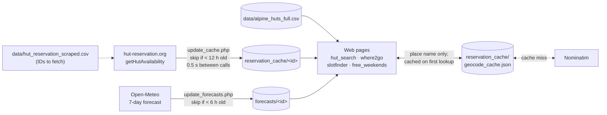

# Alpine Hut Weather Planner

Note: This tool is entirely vibe-coded and just a vibe-code test piece.

Find alpine huts near a location, check their bed availability and pick the best weekend or weather. All APIs used are free and need no sign-up.

## Pages

| Page | What it does |
|---|---|
| `hut_search.php` | Huts near a location, sorted by elevation, with cached availability per day and an OSM map |
| `where2go.php` | Huts with free beds on chosen days, ranked by a 7-day weather score |
| `slotfinder.php` | Pick huts and a group size; lists every date each hut has enough free beds (weekends / weekdays) |
| `free_weekends.php` | Weekend calendar, then the huts with N free beds on Fri + Sat night (both / one / almost) with a map; all huts or a location + radius |

The location field accepts a place name (geocoded via Nominatim) or a raw `lat,lon` pair.

## Setup

**Web UI:** PHP 8.0+ with the `curl` extension, no Composer packages.
- `reservation_cache/` and `forecasts/` must be writable by the user running PHP.
- The machine needs outbound HTTPS (port 443) to the APIs below.

**Data scripts (optional):** Python 3.10+.

```bash
python -m venv .venv
.venv/bin/pip install requests pandas
# only for data/scrape_hut_reservation.py:
.venv/bin/pip install playwright
.venv/bin/python -m playwright install chromium
```

## Run

1. Download bed availability into `reservation_cache/`:
   ```bash
   php update_cache.php 1 800                 # CLI: hut-reservation IDs 1..800
   # web: update_cache.php?start_id=1&end_id=800
   ```
   - Each ID prints `OK`, `SKIP` (still fresh), `NF` (not in CSV) or `FAIL`.
   - Logs go to `reservation_cache/update_log-1.txt`; the last 3 logs are kept.
2. Download weather forecasts into `forecasts/`, needed by `where2go.php`:
   ```bash
   php update_forecasts.php
   ```
3. Serve the pages:
   ```bash
   php -S localhost:8080
   # open http://localhost:8080/hut_search.php
   ```
   Or copy the repo to any PHP web server.
4. Keep the caches fresh, e.g. with cron. Re-running is cheap because files still within their TTL are skipped.
   ```cron
   0 */6 * * *  cd /path/to/alpine_hut && php update_cache.php 1 800 && php update_forecasts.php
   ```

## How caching works

The pages never call the availability or weather APIs while rendering. They only read local files that the update scripts fill.



- **Availability:** one JSON file per hut, holding `date`, `freeBeds`, `hutStatus` and `totalSleepingPlaces` for each day.
- **Cache age:** `slotfinder.php` and `free_weekends.php` show how old each hut's data is and flag it as stale after 12 h.
- **Geocoding:** each place name is resolved once and then read from `geocode_cache.json`. Entering `lat,lon` skips geocoding entirely.

## Hut data

- `data/alpine_huts_full.csv` holds about 4,160 huts across the Alps, merged from the SAC API, OpenStreetMap and hut-reservation.org. About 300 of them have a `reservation_id`, which is what availability is fetched for.
- `data/hut_reservation_scraped.csv` holds the hut metadata from hut-reservation.org (ID, name, coordinates, …). `update_cache.php` reads the IDs to fetch from it and skips rows marked `NOT_FOUND`.

**Check for new or changed huts on hut-reservation.org:** stdlib only, no Playwright needed.
```bash
python3 data/check_hut_reservation.py            # probe unknown/missing IDs + 50 beyond the highest
python3 data/check_hut_reservation.py --all      # also re-check known huts (CHANGED / GONE)
python3 data/check_hut_reservation.py --all --apply   # write NEW/REVIVED/CHANGED rows (CSV is backed up first)
```
Exit code: 0 = nothing new, 1 = findings, 2 = request errors only.

**Rebuild the hut database from scratch:** run the steps in this order.
```bash
cd data && ../.venv/bin/python get_huts.py && cd ..         # SAC API + Overpass → alpine_huts_full.csv
.venv/bin/python data/scrape_hut_reservation.py             # → hut_reservation_scraped.csv (set ID_FETCH_FROM / ID_END in the script)
cd data
../.venv/bin/python match_scraped_ids.py                    # assign scraped IDs to OSM rows (unclear ones → match_scraped_review.csv)
../.venv/bin/python merge_reservation_ids.py                # copy IDs onto duplicate OSM rows
../.venv/bin/python deduplicate.py                          # drop SAC/OSM duplicates sharing an ID
../.venv/bin/python fill_elevation.py                       # fill missing elevations via Open-Meteo
```
The helper scripts use paths relative to the current directory, so run them inside `data/` as shown. The scraper is the exception and runs from the repo root.

## APIs

These are all free and need no key:
- [Nominatim](https://nominatim.openstreetmap.org) for geocoding;
- [hut-reservation.org](https://www.hut-reservation.org) for availability and hut metadata;
- [Open-Meteo](https://open-meteo.com) for forecasts and elevation;
- the [SAC API](https://huts.web.sac-cas.ch/api/1/huts) and [Overpass](https://overpass-api.de) to build the hut list.

## Legacy

`legacy/` holds the earlier Python CLI tools (`hut_search.py`, `hut_weather.py`, `filter_huts.py`) and old PHP versions. They are kept for reference and are not maintained.
